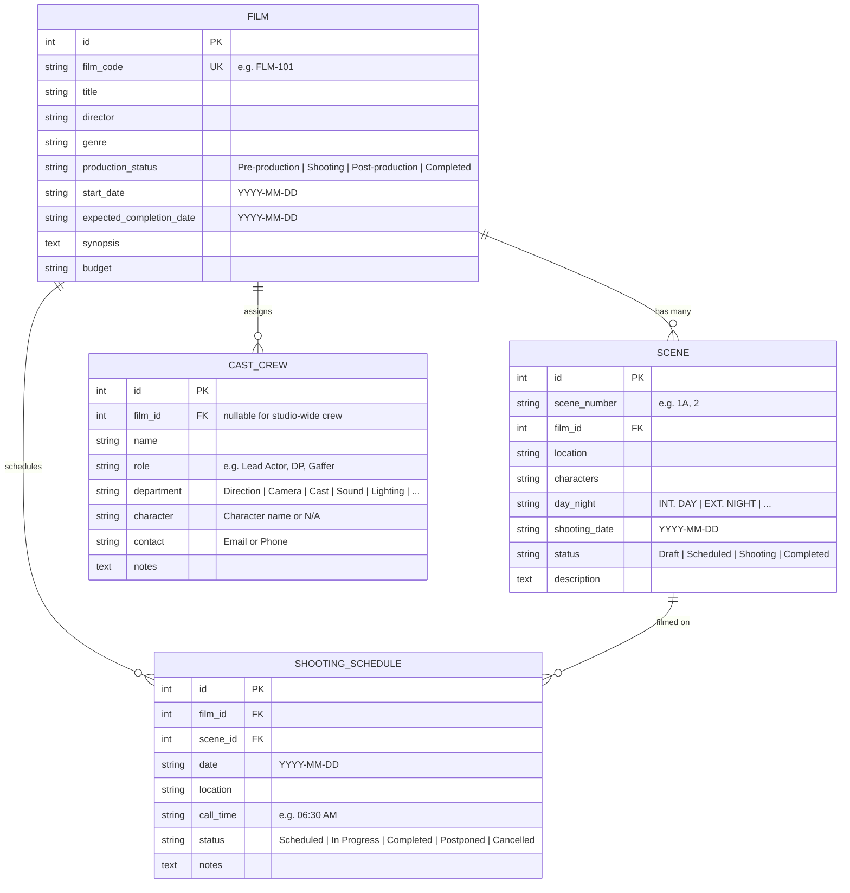

# 🎬 CineFlow &mdash; Cinema Production Management Web Application

**CineFlow** is a modern, modular web application designed for independent film studios, production companies, and small filmmaking crews to manage the complete cinematic lifecycle: film projects, scripted scenes, cast & crew rosters, daily shooting call sheets, and real-time production stage tracking.

Built with **Python**, **Flask**, **SQLite**, **HTML5**, **CSS3**, and **JavaScript**, CineFlow adheres to Software Engineering best practices including the **Application Factory pattern**, **Modular Blueprints**, **Relational Database Design (ORM)**, and a **comprehensive automated test suite**.

---

## 📋 Table of Contents
- [Project Overview](#-project-overview)
- [Key Modules & Features](#-key-modules--features)
- [Software Architecture & Design](#-software-architecture--design)
- [Database Schema (ER Diagram)](#-database-schema-er-diagram)
- [Tech Stack](#-tech-stack)
- [Prerequisites](#-prerequisites)
- [Installation & Setup](#-installation--setup)
- [Running the Application](#-running-the-application)
- [Sample Production Data](#-sample-production-data)
- [Automated Testing Suite](#-automated-testing-suite)
- [Project Directory Structure](#-project-directory-structure)
- [REST API Endpoints](#-rest-api-endpoints)

---

## 📽️ Project Overview

Independent film productions often struggle with fragmented communication across spreadsheets, paper call sheets, and disparate messaging channels. **CineFlow** centralizes film management into a cinematic, responsive dashboard that lets directors, producers, and 1st Assistant Directors (ADs):
1. Track films through 4 standard industry stages: **Pre-production**, **Shooting**, **Post-production**, and **Completed**.
2. Break down script scenes with Day/Night lighting conditions, characters, and filming status.
3. Organize cast and crew members across departments (Direction, Camera, Sound, Lighting, Wardrobe, etc.).
4. Publish daily shooting schedules with call times, soundstage locations, and equipment notes.
5. Monitor completion progress percentages in real time.

---

## 🚀 Key Modules & Features

### 1. 📊 Dashboard
- **Total Films**: Live count of projects in the studio pipeline.
- **Total Scenes**: Scripted scenes across all films.
- **Completed Scenes & Progress Meter**: Visual progress bar showing total wrapped scene percentage.
- **Upcoming Shooting Schedules**: Card feed displaying future call sheets with call times, soundstages, and cast notes.
- **Current Production Status Breakdown**: Counts and percentages across all 4 production stages.
- **Today's Shoot Banner**: Highlights active call sheets rolling cameras today.

### 2. 🎬 Film Management
- Fields: **Film ID** (`film_code`), **Film Title**, **Director**, **Genre**, **Production Status**, **Start Date**, **Expected Completion Date**, **Logline/Synopsis**, **Budget**.
- Full CRUD capabilities: Create, Read, Update, and Delete.
- Comprehensive **Film Detail View**: Displays film metadata, scene breakdown, assigned cast/crew roster, and shooting schedule timeline with one-click stage switcher.

### 3. 🎞️ Scene Management
- Fields: **Scene Number** (e.g., `1A`, `3B`), **Film Association**, **Location/Set**, **Characters Involved**, **Day or Night** (`INT. DAY`, `INT. NIGHT`, `EXT. DAY`, `EXT. NIGHT`, etc.), **Shooting Date**, **Status** (`Draft`, `Scheduled`, `Shooting`, `Completed`), **Director Notes**.
- Filter by film, status, lighting condition, and search query.
- Instant inline status updates and direct schedule links.

### 4. 👥 Cast and Crew Management
- Fields: **Name**, **Role/Title**, **Department** (`Direction`, `Cast`, `Camera`, `Lighting`, `Sound`, `Art & Props`, `Wardrobe & Makeup`, `Production & Logistics`), **Character** (for actors/cast), **Contact Details**, **Film Assignment**, **Technical Notes**.
- Filter by department and film project.
- Character field auto-adapts based on selected department.

### 5. 📅 Shooting Schedule & Call Sheets
- Fields: **Date**, **Location/Soundstage**, **Scene** (linked to film), **Call Time** (e.g., `06:30 AM`), **Status** (`Scheduled`, `In Progress`, `Completed`, `Postponed`, `Cancelled`), **Equipment/Logistics Notes**.
- Multi-view tabs: *All Schedules*, *Today's Shoots*, *Upcoming Only*, *Wrapped*.
- Scene selector dynamically auto-fills location and connects to the correct film.

### 6. ⚡ Production Status & Pipeline Board
- Interactive **Kanban Stage Pipeline**:
  - `Pre-production` &rarr; `Shooting` &rarr; `Post-production` &rarr; `Completed`
- Live scene completion metrics per film.
- Quick stage advancement dropdowns to migrate films across lifecycle phases.

---

## 🏗️ Software Architecture & Design

CineFlow follows a clean **Model-Template-View (MTV)** software architecture pattern:

```
+--------------------------------------------------------------+
|                         Browser / UI                         |
|   HTML5 + CSS3 (Cinematic Dark Theme) + Vanilla JavaScript   |
+------------------------------+-------------------------------+
                               | HTTP Requests / Forms / JSON
                               v
+--------------------------------------------------------------+
|                  Flask Application Factory                   |
|                      (create_app)                            |
+--------------------------------------------------------------+
|                         Blueprints                           |
|  /dashboard  /films  /scenes  /crew  /schedules  /production |
+------------------------------+-------------------------------+
                               | SQLAlchemy ORM
                               v
+--------------------------------------------------------------+
|                        SQLite Database                       |
|          (films, scenes, cast_crew, shooting_schedules)      |
+--------------------------------------------------------------+
```

### Architectural Highlights
- **Application Factory Pattern (`create_app`)**: Allows environment switching (development, testing with `:memory:` database, production).
- **Blueprints**: Decoupled modules with isolated routes and views.
- **SQLAlchemy ORM**: Clean object-relational mapping with cascading deletes and relationship tracking.
- **Responsive UI/UX**: Custom cinematic design system featuring glassmorphic cards, clapperboard motifs, gold/amber accents, and mobile navigation.

---

## 🗄️ Database Schema (ER Diagram)



---

## 🛠️ Tech Stack

| Component | Technology | Description |
|---|---|---|
| **Backend** | Python 3.10+ / Flask 3.x | Lightweight, high-performance web framework |
| **ORM / Database** | Flask-SQLAlchemy / SQLite | Relational database storage with zero-config setup |
| **Frontend** | HTML5, CSS3, JavaScript | Custom responsive cinematic dark theme |
| **Testing** | pytest | Automated unit and integration testing |
| **Design** | Flexbox, CSS Grid, SVG | Cinema production aesthetics & clapperboard styling |

---

## 💻 Prerequisites

Ensure you have Python 3.10 or higher installed:
```bash
python --version
```

---

## ⚡ VS Code Quickstart (1-Click Run & Debug)

If you use **Visual Studio Code**, CineFlow comes pre-configured with workspace settings, debug launch profiles, tasks, and test explorer discovery in `.vscode/`:

1. **Open the project folder in VS Code**:
   ```bash
   code d:\ciniflow
   ```
2. **Press `F5`** (or go to the **Run & Debug** tab on the left and click **🎬 CineFlow: Run & Debug Server**).
   - This starts the Flask development server on `http://127.0.0.1:5000` with live reload and debugging enabled.
3. **Run Tests via Test Explorer**:
   - Click the beaker icon (**Testing**) in the VS Code sidebar.
   - All 19 tests will be auto-discovered. You can run individual tests or the entire suite with one click.
4. **Recommended Extensions**:
   - `ms-python.python` (Python language support)
   - `ms-python.debugpy` (Debugger)
   - `samuelcolvin.jinjahtml` (Syntax highlighting for HTML/Jinja templates)
   - `qwtel.sqlite-viewer` (Inspect `cineflow.db` tables directly inside VS Code)

---

## 📦 Installation & Setup (Terminal Alternative)

1. **Clone or navigate to the repository directory:**
   ```bash
   cd d:\ciniflow
   ```

2. **Create and activate a virtual environment:**
   - **On Windows (PowerShell):**
     ```powershell
     python -m venv .venv
     .\.venv\Scripts\Activate.ps1
     ```
   - **On Windows (Command Prompt):**
     ```cmd
     python -m venv .venv
     .venv\Scripts\activate.bat
     ```
   - **On macOS / Linux:**
     ```bash
     python3 -m venv .venv
     source .venv/bin/activate
     ```

3. **Install dependencies:**
   ```bash
   pip install -r requirements.txt
   ```

---

## 🚀 Running the Application

1. **Start the Flask development server:**
   ```bash
   python run.py
   ```

2. **Open your browser and navigate to:**
   ```
   http://127.0.0.1:5000
   ```

The application automatically creates `cineflow.db` and populates it with realistic sample cinema production data on its first launch.

---

## 🎞️ Sample Production Data

CineFlow comes pre-loaded with rich, realistic sample cinema projects so the dashboard works out of the box:

- **Films**:
  1. *Shadows of Neon* (`FLM-101`) &mdash; Cyberpunk Sci-Fi Noir (Stage: *Shooting*)
  2. *The Last Sunset* (`FLM-102`) &mdash; Period Drama (Stage: *Post-production*)
  3. *Echoes of Silence* (`FLM-103`) &mdash; Psychological Mystery (Stage: *Pre-production*)
  4. *Starlight Odyssey* (`FLM-104`) &mdash; Space Adventure (Stage: *Completed*)
- **14+ Scripted Scenes** with character assignments, locations, and Day/Night settings.
- **12+ Cast & Crew Members** across Directing, Camera (ARRI Alexa 35), Lighting (Gaffer), Sound, Wardrobe, and Cast.
- **6+ Shooting Schedules** featuring call times (e.g., `06:30 AM`), rain rig setups, soundstage coordinates, and live status flags.

---

## 🧪 Automated Testing Suite

CineFlow includes an automated test suite with **19 test cases** covering models, routes, CRUD operations, relationships, and API endpoints.

Tests run on an isolated in-memory SQLite database (`sqlite:///:memory:`).

### Run Tests:
```bash
pytest -v
```

### Test Coverage Summary:
- **`tests/test_models.py`**:
  - Film creation and field validation
  - Scene completion rate calculation
  - Cast & Crew model properties and dictionary serialization
  - Shooting schedule relations and `is_upcoming` logic
  - Foreign key cascading deletion
- **`tests/test_routes.py`**:
  - Dashboard route (`/`) and core statistics verification
  - Film list and detail views
  - Scene list and filtering
  - Cast & crew directory
  - Shooting schedule views
  - Production status Kanban board
  - REST API endpoints (`/api/stats`, `/api/films/<id>/scenes`)
- **`tests/test_crud.py`**:
  - Create, edit, and delete films
  - Create, update status, and delete scenes
  - Create and remove crew members
  - Create and manage shooting schedules
  - Production stage migrations

---

## 📂 Project Directory Structure

```
d:\ciniflow\
├── app/
│   ├── __init__.py                 # Application factory (create_app) & context processors
│   ├── config.py                   # Configuration classes (Dev, Test)
│   ├── models.py                   # SQLAlchemy Models (Film, Scene, CastCrew, ShootingSchedule)
│   ├── seed_data.py                # Initial realistic cinema sample dataset
│   ├── blueprints/
│   │   ├── __init__.py
│   │   ├── dashboard/              # Module 1: Dashboard routes
│   │   │   ├── __init__.py
│   │   │   └── routes.py
│   │   ├── films/                  # Module 2: Film Management routes
│   │   │   ├── __init__.py
│   │   │   └── routes.py
│   │   ├── scenes/                 # Module 3: Scene Management routes
│   │   │   ├── __init__.py
│   │   │   └── routes.py
│   │   ├── crew/                   # Module 4: Cast & Crew routes
│   │   │   ├── __init__.py
│   │   │   └── routes.py
│   │   ├── schedules/              # Module 5: Shooting Schedule routes
│   │   │   ├── __init__.py
│   │   │   └── routes.py
│   │   ├── production/             # Module 6: Production Status routes
│   │   │   ├── __init__.py
│   │   │   └── routes.py
│   │   └── api/                    # REST JSON Endpoints
│   │       ├── __init__.py
│   │       └── routes.py
│   ├── static/
│   │   ├── css/
│   │   │   └── style.css           # Cinematic dark theme design system
│   │   ├── js/
│   │   │   └── main.js             # Mobile toggle, alert dismiss, dynamic form helpers
│   │   └── img/
│   │       └── logo.svg            # Custom SVG cinema clapper logo
│   └── templates/
│       ├── base.html               # Shared layout, navbar, flash messages & footer
│       ├── dashboard/
│       │   └── index.html          # Main dashboard view
│       ├── films/
│       │   ├── index.html          # Film catalogue
│       │   ├── form.html           # Add / Edit Film form
│       │   └── detail.html         # Film detail view
│       ├── scenes/
│       │   ├── index.html          # Scene slate view
│       │   └── form.html           # Add / Edit Scene form
│       ├── crew/
│       │   ├── index.html          # Cast & Crew directory
│       │   └── form.html           # Add / Edit Crew form
│       ├── schedules/
│       │   ├── index.html          # Call sheets list & calendar
│       │   └── form.html           # Add / Edit Call Sheet form
│       └── production/
│           └── index.html          # Kanban Production Stage Pipeline
├── tests/
│   ├── __init__.py
│   ├── conftest.py                 # Pytest fixtures and in-memory test DB
│   ├── test_models.py              # Model unit tests
│   ├── test_routes.py              # HTTP route integration tests
│   └── test_crud.py                # CRUD operations tests
├── cineflow.db                     # SQLite database (auto-created on startup)
├── Jenkinsfile                     # Declarative Jenkins CI/CD pipeline
├── requirements.txt                # Pinned Python dependencies
├── run.py                          # Application entry point
└── README.md                       # Complete software engineering documentation
```

---

## 🔄 CI/CD Integration with Jenkins

CineFlow includes a cross-platform Declarative **`Jenkinsfile`** supporting both Windows and Linux Jenkins agents.

### Pipeline Stages
1. **Checkout**: Pulls source code from GitHub (`https://github.com/sanjaybharadwaj014-create/cineflow.git`).
2. **Setup Python Environment**: Creates an isolated `.venv` (using `uv` or `python -m venv`) and installs `requirements.txt`.
3. **Syntax & Lint Check**: Compiles all Python modules (`compileall`) to catch syntax errors early.
4. **Run Automated Tests (`pytest`)**: Executes all 19 test cases and publishes JUnit XML results (`reports/junit.xml`).
5. **Application Smoke Verification**: Boots the Flask app factory with `TestConfig` and verifies HTTP 200 across all 7 routes.

### Connecting in Jenkins
1. Open Jenkins at **`http://localhost:8080`**.
2. Click **New Item** → name it `cineflow-ci` → choose **Pipeline** → **OK**.
3. Under **Triggers**, enable **Poll SCM** (e.g. `H/5 * * * *`) or **GitHub hook trigger for GITScm polling**.
4. Under **Pipeline**, set **Definition** to **Pipeline script from SCM** → **SCM**: `Git` → **Repository URL**: `https://github.com/sanjaybharadwaj014-create/cineflow.git` → **Branch Specifier**: `*/main` → **Script Path**: `Jenkinsfile`.
5. Save and click **Build Now**.

---

## 🌐 REST API Endpoints

In addition to HTML views, CineFlow provides JSON endpoints:

| Endpoint | Method | Description | Sample Output |
|---|---|---|---|
| `/api/stats` | GET | Returns global production metrics | `{"total_films": 4, "total_scenes": 14, ...}` |
| `/api/films/<id>/scenes` | GET | Returns all scenes for a specific film | `[{"scene_number": "1A", "location": "EXT. Alley", ...}]` |

---

## 🎓 Software Engineering Academic Relevance

This project satisfies standard Software Engineering college course criteria:
- **Clean Architecture**: Application Factory pattern with blueprint decomposition.
- **Relational Integrity**: Foreign key constraints, cascade rules, and normalized tables.
- **Separation of Concerns**: Isolated templates, stylesheets, JavaScript, database models, and test suites.
- **Defensive Programming**: Form input validation, CSRF consideration, and error handling with user flash alerts.
- **Automated Verification**: Test-Driven Development (TDD) ready with `pytest`.
